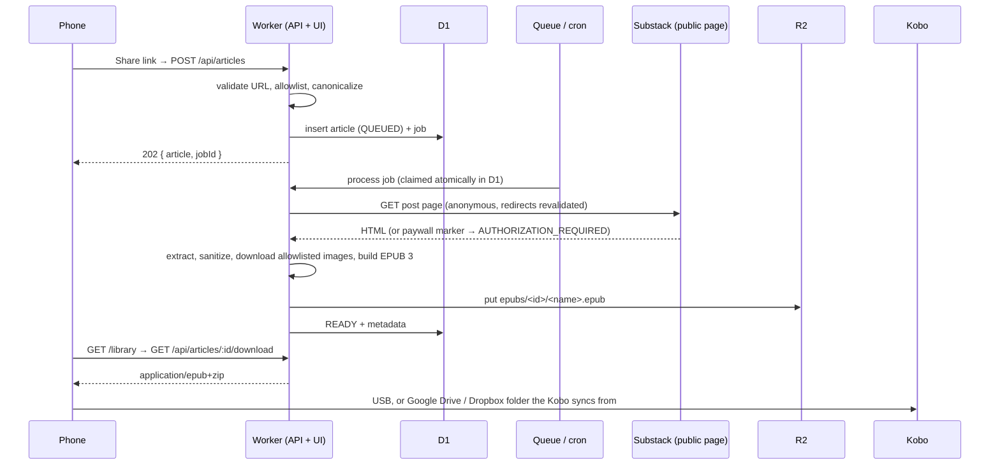

# Substack → Kobo

A self-hosted, single-user reading pipeline on Cloudflare: save a Substack post from your phone, get a clean EPUB 3 in a private library, and read it on a Kobo Libra Colour.

The system processes **only the links you explicitly submit**. It never crawls your subscriptions, feeds, inbox or recommendations, and it never bypasses paywalls: subscriber-only posts stop with a clear status and a manual-import path for content you are entitled to use.

## How it works



Full details: [docs/ARCHITECTURE.md](docs/ARCHITECTURE.md). Device workflow: [docs/KOBO.md](docs/KOBO.md). Phone workflows: [docs/MOBILE.md](docs/MOBILE.md). Operations, backups and troubleshooting: [docs/OPERATIONS.md](docs/OPERATIONS.md). Security model: [docs/SECURITY.md](docs/SECURITY.md).

## Stack

| Concern | Choice | Why |
|---------|--------|-----|
| Runtime | Cloudflare Workers (TypeScript, ES2022) | No servers; one deploy for API, UI, queue consumer and cron |
| HTTP | [Hono](https://hono.dev) 4 | Small, Workers-native router with typed context |
| Metadata | D1 (SQLite) | Relational metadata, job state, sessions; migrations in `migrations/` |
| Files | R2 (private bucket) | EPUBs and manual-import payloads |
| Async | Cloudflare Queues when available, else inline `waitUntil` + cron sweep | D1 stays the source of truth either way; see Architecture |
| HTML parsing | `htmlparser2` + `domhandler` | Pure JS, no DOM/Node dependencies, verified in the Workers runtime by the test suite |
| ZIP/EPUB | `fflate` + a small EPUB 3.3 packager (`src/epub`) | No EPUB library runs in Workers without filesystem assumptions; output validated with W3C EPUBCheck |
| Validation | `zod` 4 | Request and import payload schemas |
| UI | Static HTML/CSS/JS served by Workers Static Assets through the Worker (auth first) | Zero frontend dependencies, fast on phones, installable as a share target on Android |
| Tests | Vitest 4 + `@cloudflare/vitest-plugin` (tests run inside workerd with real D1/R2) | Same runtime as production |
| Lint/format | Biome | One tool for TS, JS, JSON, CSS |

Everything runs under the Workers runtime; no Node.js filesystem or process APIs are used in `src/`.

## Project structure

```
.
├── wrangler.jsonc            Worker config: bindings, assets, queues, cron
├── migrations/0001_init.sql  D1 schema (articles, processing_jobs, sessions, rate_limits)
├── public/                   Static UI: index (capture), library, login, app.js/css, PWA manifest
├── src/
│   ├── index.ts              fetch / queue / scheduled entry points
│   ├── app.ts                Hono app, middleware, error mapping, security headers
│   ├── env.ts                Bindings and AppConfig
│   ├── types.ts              Domain types, statuses, AppError
│   ├── auth/                 WebCrypto helpers, sessions, middleware, rate limiting
│   ├── capture/              URL policy (allowlist, SSRF, canonicalization) and capture service
│   ├── acquisition/          ContentSource interface, public page source, manual import, sanitizer, images
│   ├── epub/                 EPUB 3 generator, cover, stylesheet, filenames, structural validator
│   ├── db/                   D1 repositories
│   ├── storage/              R2 wrapper
│   ├── jobs/                 processor, dispatcher, scheduler (cron), queue consumer, backoff
│   ├── library/              Library/read model and article actions
│   ├── delivery/             Delivery adapters (direct download implemented)
│   ├── observability/        Structured JSON logger
│   └── routes/               API routes (auth, articles) and page routes
├── test/                     Vitest suites (unit + integration) and HTML fixtures
├── scripts/                  secret generator, sample EPUB, EPUBCheck runner
└── docs/                     Architecture, Kobo, Mobile, Operations, Security
```

## Prerequisites

* Node.js 20+ and pnpm 10 (`corepack enable` or `npm i -g pnpm`)
* A Cloudflare account with Workers. Processing an article takes tens of milliseconds of CPU, which exceeds the Free plan's 10 ms per-invocation budget; **Workers Paid ($5/month) is required in practice**. R2, D1 and Queues all have free tiers that cover personal use; R2 must be enabled once in the dashboard.
* Wrangler 4 (installed as a dev dependency; run via `pnpm exec wrangler` or `pnpm run <script>`)
* Java 11+ only if you want to run EPUBCheck locally (`pnpm run epub:check`)

## Local development

```bash
pnpm install
cp .dev.vars.example .dev.vars        # then edit: pnpm run secret:generate prints strong values
pnpm run db:migrate:local             # applies migrations to the local D1 emulator
pnpm run dev                          # http://localhost:8787
```

Open http://localhost:8787, sign in with the `AUTH_PASSWORD` from `.dev.vars`, paste a public Substack post URL. Local R2, D1 and Queues are emulated by Wrangler; no production credentials are needed. Over plain http the session cookie is named `sk_session` (the `__Host-` prefix requires https).

### Commands

| Command | Purpose |
|---------|---------|
| `pnpm run dev` | Local dev server with emulated bindings |
| `pnpm run test` / `pnpm run test:watch` | Run tests inside workerd (D1 migrations applied automatically) |
| `pnpm run typecheck` | `tsc --noEmit` |
| `pnpm run lint` / `pnpm run lint:fix` / `pnpm run format` | Biome |
| `pnpm run check` | lint + typecheck + test |
| `pnpm run build` | `wrangler deploy --dry-run` bundle check |
| `pnpm run epub:sample` | Generate `tmp/sample.epub` from the fixture article |
| `pnpm run epub:check [file]` | Validate with W3C EPUBCheck (Java) |
| `pnpm run secret:generate` | Print random values for the three secrets |
| `pnpm run db:migrate:local` / `db:migrate:remote` | Apply D1 migrations |

## Configuration

### Variables (`wrangler.jsonc` → `vars`)

| Name | Default | Meaning |
|------|---------|---------|
| `ALLOWED_HOSTS` | `""` | Extra hostnames allowed for article URLs, comma-separated (e.g. custom Substack domains such as `www.platformer.news`). `substack.com` and `*.substack.com` are always allowed. Patterns: exact host or `*.example.com`. |
| `ALLOWED_IMAGE_HOSTS` | `""` | Extra image hosts. `substackcdn.com`, `*.substackcdn.com` and Substack's S3 buckets are always allowed. |
| `INCLUDE_IMAGES` | `"true"` | Set `"false"` for text-only EPUBs |
| `MAX_JOB_ATTEMPTS` | `"5"` | Automatic retry budget per job |
| `APP_NAME` | `"Substack to Kobo"` | Shown in the EPUB footer |

### Secrets (never in source control)

| Name | Required | Purpose |
|------|----------|---------|
| `AUTH_PASSWORD` | yes | Login password (use 24+ random characters) |
| `SESSION_SECRET` | yes | ≥ 32 characters; signs session cookies |
| `API_TOKEN` | no | Bearer token for iOS Shortcuts / automations |

Local values go in `.dev.vars` (see `.dev.vars.example`). Production values: `wrangler secret put <NAME>`. Rotation is documented in [docs/OPERATIONS.md](docs/OPERATIONS.md).

## Deployment with GitHub Actions

`.github/workflows/deploy.yml` lints, tests, creates the queues if missing, applies D1 migrations and deploys on every push to `main`. Add these repository secrets once (Settings › Secrets and variables › Actions): `CLOUDFLARE_API_TOKEN` (Workers Scripts, D1, Workers R2 Storage and Queues edit permissions), `CLOUDFLARE_ACCOUNT_ID`, and the application secrets `AUTH_PASSWORD`, `SESSION_SECRET`, `API_TOKEN` (generate with `pnpm run secret:generate`). The R2 bucket must exist first (`wrangler r2 bucket create substack-kobo-epubs`, after enabling R2 in the dashboard).

## Deployment from a clean checkout (manual)

```bash
pnpm install
pnpm exec wrangler login

# 1. Create resources
pnpm exec wrangler d1 create substack-kobo-db
#    → copy the database_id into wrangler.jsonc (d1_databases[0].database_id)
pnpm exec wrangler r2 bucket create substack-kobo-epubs
pnpm exec wrangler queues create substack-kobo-jobs          # optional, see below
pnpm exec wrangler queues create substack-kobo-jobs-dlq      # optional dead-letter queue

# 2. Schema
pnpm run db:migrate:remote

# 3. Secrets
pnpm run secret:generate
pnpm exec wrangler secret put AUTH_PASSWORD
pnpm exec wrangler secret put SESSION_SECRET
pnpm exec wrangler secret put API_TOKEN                      # optional

# 4. Deploy
pnpm run check
pnpm run deploy
```

The deploy output prints the `*.workers.dev` URL; add a custom domain under **Workers › Settings › Domains** if you prefer. Visit `/login` on your phone and follow [docs/MOBILE.md](docs/MOBILE.md) to add the capture page to your share sheet.

### Queues: optional

`wrangler.jsonc` ships with a queue producer and consumer because they give immediate, reliable background processing with Cloudflare-managed delivery. Queues is included in the Workers Free plan (10,000 operations/day). If you prefer not to use it, delete the `queues` block. The code detects the missing `ARTICLE_QUEUE` binding and processes each job right after the capture response via `waitUntil`, with the one-minute cron trigger as the safety net for retries and anything that did not finish. All tests cover both paths.

### Cron

`triggers.crons` is `* * * * *` (every minute): recovers stale jobs, dispatches due retries, prunes sessions. Change it if you prefer fewer invocations; retries simply wait for the next tick.

## Using it

1. **Save**: bookmark in the Substack app as usual; then Share → the installed capture page (Android) or Shortcut/paste (iOS). The capture page shows live status and a download button when ready.
2. **Library** (`/library`): search by title/author/publication, filter by status, download, retry, delete, open the original.
3. **Kobo**: download the EPUB and copy via USB, or save it to the Google Drive / Dropbox folder your Kobo is linked to and tap Sync. Details and caveats in [docs/KOBO.md](docs/KOBO.md).

### Statuses

| Status | Meaning | Action |
|--------|---------|--------|
| `QUEUED` / `PROCESSING` | Waiting / working | Wait; the page refreshes itself |
| `READY` | EPUB stored | Download |
| `RETRYABLE_ERROR` | Temporary failure (5xx, 429, timeout, storage) | Automatic retry with exponential backoff (1m, 2m, 4m…, max 5 attempts) |
| `AUTHORIZATION_REQUIRED` | Paywalled or login-protected post | Manual import of content you are entitled to use; or retry later if the post becomes public |
| `CONTENT_UNAVAILABLE` | Not found, not a post, redirected to a host outside the allowlist, too large | Check the link; add the host to `ALLOWED_HOSTS`; or manual import |
| `FAILED` | Retry budget exhausted or duplicate detected after fetch | Retry manually (resets the budget) or delete |

## Testing

```bash
pnpm run test
```

Tests run inside the Workers runtime with isolated D1/R2 per test file and the real migrations. Outbound `fetch` is stubbed so no network is needed. Coverage includes: URL validation and canonicalization, SSRF protections (IP literals, metadata hosts, redirects to disallowed hosts), deduplication (including concurrent and post-fetch canonical collisions), migrations, job claiming under duplicate deliveries, backoff and max attempts, stale-lease recovery, queue consumer acknowledgements, EPUB generation and package structure, metadata and Unicode handling, R2 failures, authentication (cookie, bearer, CSRF, rate limits, forged cookies), unauthorized downloads, manual import, paywalled and unavailable content.

`pnpm run epub:check` validates the generated sample against the official W3C EPUBCheck (requires Java).

## Known limitations

* **No automatic saved-list discovery.** Substack does not offer a documented API for a user's bookmarks or post bodies. Submitting a URL converts that URL only. The `ContentSource` interface and `enqueueArticle` are the extension points if an official integration appears.
* **Custom publication domains must be allowlisted.** Posts on `*.substack.com` work out of the box; publications on their own domains need an entry in `ALLOWED_HOSTS`. The error message tells you which host to add.
* **Paywalled content is not fetched.** It is reported as `AUTHORIZATION_REQUIRED` and can be imported manually.
* **Layout changes at Substack can break extraction.** The extractor relies on the rendered page's body container and standard metadata; if it fails, articles end in `CONTENT_UNAVAILABLE` and manual import still works.
* **Covers are SVG.** They render in the book; Kobo library thumbnails for SVG covers vary by firmware.
* **No cloud delivery adapter yet.** Direct download is implemented; Google Drive / Dropbox upload adapters are future work (the device-side sync from those folders is a Kobo feature and works today manually).
* **Rate limiting is per-isolate D1 counters**, adequate for a personal system; put Cloudflare Access/WAF in front for anything stronger.
* **Free plan.** CPU limits on the Free plan are too small for HTML parsing plus ZIP generation of larger articles; use Workers Paid.
