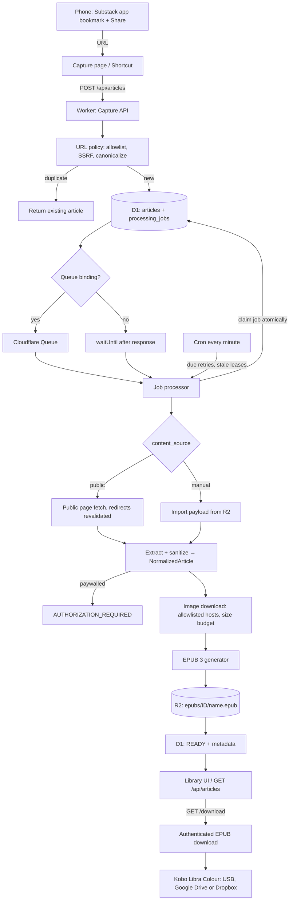

# Architecture

A single Cloudflare Worker hosts the API, the static UI, the queue consumer and the cron handler. D1 holds metadata and the job queue state; R2 holds EPUB files and manual-import payloads. Nothing runs outside Cloudflare.

## Modules

| # | Module | Location | Responsibility |
|---|--------|----------|----------------|
| 1 | Capture API | `src/routes/articles.ts`, `src/capture/captureService.ts` | `POST /api/articles`: validate, deduplicate, persist, dispatch |
| 2 | Validation & dedup | `src/capture/urlPolicy.ts` | URL parsing, allowlist, SSRF rules, canonicalization (the dedup key) |
| 3 | Content acquisition | `src/acquisition/*` | `ContentSource` interface with two implementations: public page fetch and manual import |
| 4 | EPUB generation | `src/epub/*` | EPUB 3.3 packaging on fflate, cover, stylesheet, filenames, structural validator |
| 5 | D1 repository | `src/db/*` | Articles, jobs (claim/retry/lease), sessions, rate-limit counters |
| 6 | R2 storage | `src/storage/r2.ts` | EPUB and import objects; keys are internal |
| 7 | Background processing | `src/jobs/*` | Processor, dispatcher (Queues or inline), cron maintenance, queue consumer |
| 8 | Library UI | `public/*`, `src/routes/pages.ts` | Capture page, library, login; served through the Worker behind auth |
| 9 | Download | `src/routes/articles.ts` (`/download`), `src/delivery/*` | Authenticated streaming of the EPUB with correct headers |
| 10 | Auth | `src/auth/*` | Password login → signed session cookie; optional bearer API token; CSRF and rate limiting |

## Data flow

## Request lifecycle

1. `POST /api/articles` authenticates (cookie or bearer), rate-limits, validates the body.
2. `canonicalizeArticleUrl` rejects anything that is not an https URL on an allowlisted host, rewrites `open.substack.com/pub/<pub>/p/<slug>` share links, strips query strings and fragments.
3. If an article with that canonical URL exists it is returned with `duplicate: true` (HTTP 200). Otherwise an `articles` row (QUEUED) and a `processing_jobs` row are inserted and the job is dispatched. The response (HTTP 202) carries the article and job id. The request never waits for processing.
4. The processor claims the job with a conditional `UPDATE` (status in QUEUED/WAITING_RETRY, due, attempts < max). Only one claimant wins, so duplicate queue deliveries and cron/queue overlap are harmless.
5. The content source produces a `NormalizedArticle` or throws a typed `AppError`.
6. Images are downloaded under their own allowlist and size budget; failures just omit the image.
7. The EPUB is built in memory, written to R2, and the article is marked READY with filename, size and content hash.
8. Errors map to article statuses: `AUTHORIZATION_REQUIRED`, `CONTENT_UNAVAILABLE` and `FAILED` are terminal; `RETRYABLE_ERROR` schedules exponential backoff (1m, 2m, 4m… capped at 1h, max 5 attempts by default). After the budget is exhausted the article becomes `FAILED` with `MAX_ATTEMPTS_EXCEEDED`; the user can retry manually, which resets the budget.
9. The cron handler re-queues jobs whose lease (3 minutes) expired mid-processing, dispatches due retries (bounded per run) and prunes sessions and counters.

## Dispatch strategy

D1 is always the source of truth. Cloudflare Queues is used purely as a wake-up signal when the `ARTICLE_QUEUE` binding exists; the consumer acknowledges every message (even failures) and relies on D1 for retry scheduling so the two retry mechanisms never compound. Without the binding the job runs via `ctx.waitUntil` right after the capture response, and the cron sweep is the safety net for anything that did not finish.

## Content acquisition boundary

`ContentSource.fetchArticle(request, deps)` is the only thing the processor knows about content. Two sources ship:

* `SubstackPublicHtmlSource`: fetches the public post page anonymously (no cookies, no credentials), follows at most 5 redirects while re-validating each destination, caps the body at 5 MB and 20 s, then extracts the article from the rendered markup and standard metadata (Open Graph, JSON-LD). A paywall marker or `isAccessibleForFree: false` results in `AUTHORIZATION_REQUIRED` rather than a truncated EPUB.
* `ManualImportSource`: reads the payload the user supplied (`imports/<articleId>.json` in R2), sanitizes it with the same pipeline and produces the same `NormalizedArticle`.

A future officially supported Substack integration (for example a saved-list API) would be a third `ContentSource` plus a small discovery module that calls `enqueueArticle` for each saved item. Nothing in processing, EPUB generation, storage or the UI would change.

## Storage model

See `migrations/0001_init.sql`. Key points:

* `articles.canonical_url` is unique: the deduplication guarantee lives in the database, and concurrent submissions resolve by catching the unique violation.
* `processing_jobs` has a partial unique index allowing only one non-terminal job per article.
* No article body is stored in D1. EPUBs live in R2 under `epubs/<articleId>/<ascii-name>.epub`; manual imports under `imports/<articleId>.json`. Object keys are never exposed by the API.
* Deleting an article removes the R2 objects first, then the rows (jobs cascade). If R2 deletion fails the row stays so the user can retry.

## Observability

Every log line is JSON with `event`, `level`, `ts`, and a correlation context (`requestId` from `cf-ray`, `jobId`, `articleId`). Events include `capture.accepted`, `capture.duplicate`, `http.client_error`, `job.started`, `job.completed`, `job.retry_scheduled`, `job.failed`, `job.lease_recovered`, `acquisition.complete`, `images.downloaded`, `epub.generated`, `r2.put_failed`, `download.served`, `maintenance.complete`. Keys that look like secrets are redacted and long strings truncated; article text is never logged.
